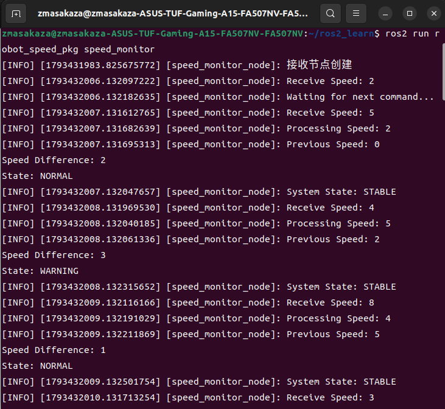
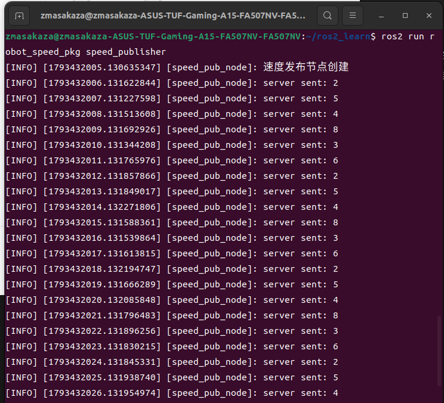

# Simualtion-Testing-Discussion

这是一个 ROS 2 仿真题的代码展示仓库，旨在汇总多人实现方案中的优点，并展示最终的项目运行效果。

- 每个分支对应一位创作者提交的代码。
- `main` 分支整合了各位创作者代码中的内容。
- 本项目目前仅支持在 Linux 系统下运行。

## 使用方法

你可以通过以下两种方式运行项目：

1. 从 [Releases](https://github.com/masakaza/Simualtion-Testing-Discussion/releases) 下载已经编译好的二进制文件，直接运行。
2. 下载项目源码，按照[从源码构建](#从源码构建)中的步骤自行编译后运行。

### 运行二进制文件

从 Releases 下载二进制文件并解压后，打开终端，切换到二进制文件所在目录，然后执行以下命令：

```bash
cd 二进制文件目录
./speed_monitor
./speed_publisher
```

> **注意：** `speed_monitor` 和 `speed_publisher` 需要分别在两个终端中运行。

## 运行效果

以下是两个程序运行时的界面截图。

**speed_monitor 运行画面：**



**speed_publisher 运行画面：**



## 从源码构建

### 构建环境

构建前，请确认系统环境满足以下要求：

- Ubuntu 22.04
- ROS 2 Humble：[ROS 2 使用教程](https://github.com/Rechardluxry/ROS2_Tuition)

### ROS 2 安装教程

ROS 2 的安装过程可以参考：[鱼香 ROS 机器人教程](https://www.bilibili.com/video/BV1Jz421B7Ey?t=1.0)。

### 构建步骤

#### 1. 获取项目源码

通过 `git clone` 命令下载仓库源码：

```bash
cd ~
git clone https://github.com/masakaza/Simualtion-Testing-Discussion.git
cd ~/Simualtion-Testing-Discussion
```

#### 2. 创建 ROS 2 工作空间

如果你已经创建了 ROS 2 工作空间，可以跳过此步骤。

```bash
cd ~
mkdir -p ros2_workspace/src
cd ~/ros2_workspace
colcon build
```

执行完成后，工作空间目录下应当生成 `build`、`install`、`log` 和 `src` 四个目录。

#### 3. 将功能包复制到工作空间

将项目中的 `robot_speed_pkg` 功能包复制到 ROS 2 工作空间的 `src` 目录下，然后进入工作空间：

```bash
cp -r ~/Simualtion-Testing-Discussion/robot_speed_pkg ~/ros2_workspace/src
cd ~/ros2_workspace
colcon build --packages-select robot_speed_pkg
```

#### 4. 运行程序

编译成功后，加载工作空间环境，并运行节点：

```bash
cd ~/ros2_workspace
. install/setup.bash
ros2 run robot_speed_pkg speed_monitor
ros2 run robot_speed_pkg speed_monitor
```

> **注意：** 两个程序需要分别在两个终端中运行。每打开一个新终端，都需要先执行前两条命令加载工作空间环境，再运行对应的程序。
